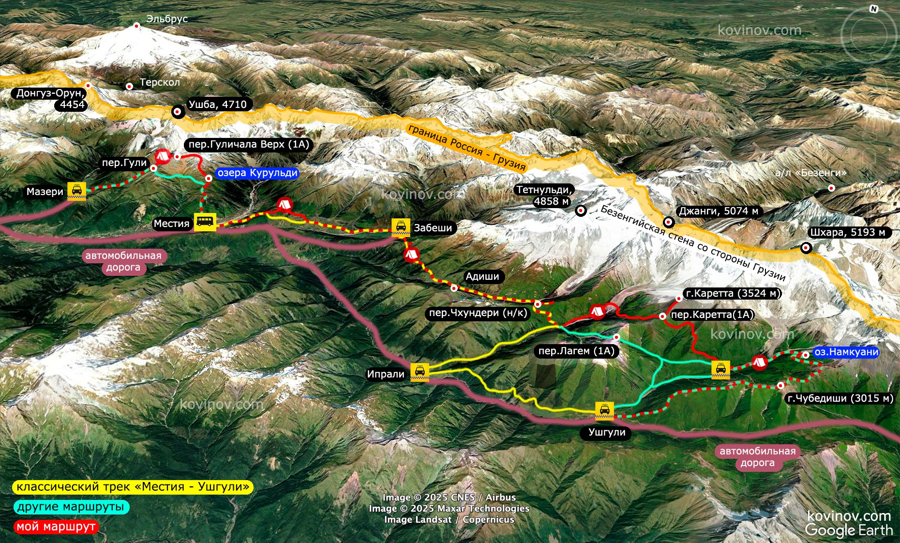

> Сванетия — это горно-походный рай. Но главное — именно здесь самый красивый Кавказ из того, что я видел.

Это не классический трек Местия — Ушгули, а его более длинная и спортивная версия: с дополнительными высокогорными участками, перевалами и выходами к ледниковым зонам. Поход в итоге стал одиночным: друзья не смогли поехать, а менять семейные планы было уже поздно.

## Маршрут в цифрах

| Параметр | Значение |
| --- | --- |
| Район | Сванетия, Грузия |
| Продолжительность | От 7 дней |
| Пройденное расстояние | 98 км |
| Набор высоты | +7700 м |
| Стартовая масса рюкзака | 12–14 кг |

*Красным отмечена спортивная линия, жёлтым — классический трек Местия — Ушгули, бирюзовым — альтернативные варианты.*

## Как появился маршрут

Идея пройтись по Сванетии появилась у меня ещё осенью 2018 года. Тогда я увидел фотографии района и добавил его в список будущих походов. Позже друзья предложили не ограничиваться классическим треком, а добавить к нему два высокогорных участка.

Перед основной линией планировался переход от Мазери к Местии: при подходящих снежных условиях — через вершину Курульди и связку перевалов Гульба-1 и Гуличала Верхний, с ночёвкой под Ушбой. В конце маршрута — выход к леднику Зарешо-Халде, перевал Каретта и, если позволят погода и силы, траверс хребта Чубедиши с озером Намкуани и видом на Шхару.

> План маршрута в высокогорье — не обещание пройти каждую линию. Снег, погода и состояние склонов могут потребовать изменить или отменить участок.

## Почему пошёл один

Когда попутчики один за другим отказались, я решал, отменять поездку или идти соло. В пользу поездки были три вещи: желание впервые увидеть Грузию, опыт предыдущих одиночных путешествий и уверенность, что мой опыт горных походов достаточен для более ответственного формата.

После нескольких обновлений снаряжения стартовый рюкзак ожидался весом около 12–14 кг. Это тоже повлияло на решение, но не заменяло оценку условий и собственных возможностей на маршруте.

## Дневник прохождения

> Этот раздел в исходном отчёте пока не заполнен. Здесь позже появятся этапы по дням, фотографии, заметки о погоде, ночёвках и изменениях маршрута.

### День 1. Мазери — Местия

*Добавить фактическое описание перехода, трек дня и фотографии.*

### Дни 2–… Основной маршрут

*Добавить дневник прохождения. Не переносить плановые участки в список пройденных, пока это не подтверждено треком.*

## Когда ехать

- **Конец июня** — на классическом треке уже может быть красиво и малолюдно, но выше сохраняется снег, реки полноводны, а погода нестабильна.
- **Первая половина июля** — авторский компромисс между зеленью, более устойчивой погодой и меньшим числом туристов, чем в пик сезона.
- **Август** — более стабильная погода и подходящее время для планов с выходами к ледникам; в стороне от тропы может быть высокая трава.
- **Октябрь** — яркие осенние краски, но погода менее предсказуема.

В конце июня 2025 года автор попал на циклоны и потерял почти неделю, пережидая непогоду. Для спортивного варианта это особенно важно: сезонная рекомендация не заменяет актуальный прогноз и оценку состояния снега.

## Направление движения

Для классического трека автор рекомендует идти из Местии в сторону Ушгули: так нагрузка и высота нарастают плавнее. Фактический маршрут был перестроен из-за прогноза: участок Местия — Мазери прошёлся раньше, а выход на основную линию отложен до улучшения погоды.

## Карта

Интерактивная карта маршрута встроена ниже. Если внешний сервис недоступен, ориентируйтесь на сохранённую схему маршрута и офлайн-трек.

<iframe
  src="https://mapmagic.app/embed?routes=0XB41K9&b=M&title=Сванетия"
  title="Карта маршрута по Сванетии"
  loading="lazy"
  referrerpolicy="no-referrer"
  allowfullscreen
  width="100%"
  height="560"
></iframe>

## Снаряжение

Полный список из 98 предметов с моделями и весом до грамма автор вынес в [таблицу снаряжения](https://docs.google.com/spreadsheets/d/1BMP1Eq0MfXgmgRlO3tJ1472CXwO0nB96ylFmuaPGTAU/edit?usp=sharing).

## Важное замечание о безопасности

В исходном отчёте автор описывает прохождение западного склона перевала Гульба-1 в конце июня 2025 года по мягкому снегу без специального снаряжения. Это описание конкретных условий одного дня, **не рекомендация повторять этот вариант**. Необходимость кошек, ледоруба, каски и страховки определяется фактическим состоянием склона, погодой и подготовкой группы.

## Изменения на 2026 год

Перед поездкой проверьте актуальные правила въезда и требования к медицинской страховке и страховке от несчастных случаев на весь срок пребывания. Требования могут меняться; сверяйтесь с официальными источниками непосредственно перед поездкой.

## Что ещё почитать

- [Все маршруты по Кавказу](../../routes/)
- [Снаряжение для этого похода](../../)
- [Задать вопрос автору в Telegram](https://t.me/kovinov/665)
